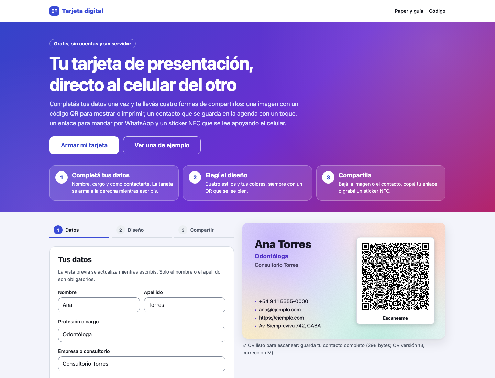

<div align="center">

# QR Business Card

**Tarjeta digital.** Armá tu tarjeta en tres pasos y compartila como contacto (.vcf), como imagen con un QR que cualquier cámara convierte en contacto, por AirDrop, o con un enlace propio que podés grabar en un sticker NFC. Sin servidor, sin dependencias y con un codificador QR propio.

[**▶ Probala en vivo**](https://loiaconobruno.github.io/qr-business-card/) · [**📄 Paper y guía**](https://loiaconobruno.github.io/qr-business-card/guia.html) · [Cómo funciona](#cómo-funciona) · [Limitaciones](#limitaciones)

[](https://github.com/LoiaconoBruno/qr-business-card/actions/workflows/tests.yml)


[](LICENSE)



</div>

Página para armar tu tarjeta de presentación y darla **sin que el otro tenga que instalar nada**. Hay cuatro formas: un **contacto ordenado (.vcf)**; una **imagen de la tarjeta con un código QR** que, escaneado con la cámara de cualquier teléfono, agrega el contacto; un **enlace propio** que abre tu tarjeta con un botón «Agregar contacto»; y ese mismo enlace **grabado en un sticker NFC**, que se abre al acercar el teléfono.

Es el "prototipo sin app" de la idea "intercambio digital de tarjetas de presentación": guardar el contacto ordenado y, además, una imagen para la galería. Mucha gente recuerda **cómo se veía** una tarjeta, no el nombre de la persona.

## Por qué

El problema que decide todo en estas apps es que el otro no tenga la app. El QR con el contacto adentro funciona en cualquier teléfono. Y como la imagen lleva el QR, **la foto misma sirve para volver a importar el contacto** (la mejora que proponía la idea). El enlace y el sticker NFC suman lo más parecido a "acercar el celular" que permite una página web.

## Instalación

No hace falta instalar nada: **[abrila en el navegador](https://loiaconobruno.github.io/qr-business-card/)**.

Para usarla sin conexión o modificarla:

```bash
git clone https://github.com/LoiaconoBruno/qr-business-card.git
```

Después abrí `index.html` con doble clic. No hay dependencias ni paso de build. Los tests corren con Node 22, la versión del CI:

```bash
npm test
```

## Uso

Abrí la [demo en vivo](https://loiaconobruno.github.io/qr-business-card/) o `index.html` con doble clic. Ejemplo:

1. **Datos.** Apretá **Cargar ejemplo**: Ana Torres, odontóloga, con teléfono, email, web, dirección y una nota de horarios (datos inventados). Debajo de la vista previa aparece "✓ QR listo para escanear: guarda tu contacto completo (298 bytes; QR versión 13, corrección M)." Si querés, sumá una foto o un logo.
2. **Diseño.** Elegí una de las cinco plantillas: Aurora, Grafito, Papel, Océano o Mínima. Cada una muestra tu tarjeta en miniatura.
3. **Compartir.**
   - **Compartir** abre la hoja de compartir del sistema con la imagen y el contacto juntos. En iPhone, iPad y Mac, ahí está AirDrop.
   - **Descargar imagen (PNG)** baja `ana-torres-tarjeta.png` (1050 × 600 px, una tarjeta de 3,5 × 2 pulgadas a 300 ppp). **Descargar contacto (.vcf)** baja `ana-torres.vcf`.
   - **Tu enlace** dice "263 caracteres, comprimido. Grabado en un tag NFC ocupa 268 bytes." y marca en qué tags entra: NTAG215 y NTAG216, pero no NTAG213. **Abrir** muestra la tarjeta de Ana con «Agregar contacto».
   - En Chrome para Android aparece **Grabar en tag NFC**. En los demás navegadores, la guía "Cómo grabar el enlace con NFC Tools" explica cómo grabarlo con una app.

## Cómo funciona

- **Flujo en tres pasos** (Datos → Diseño → Compartir) con vista previa en vivo y validación de cada campo: nombre o apellido obligatorio, teléfono de 6 a 15 dígitos con un + solo al principio, email con forma de email, web con o sin `https://` y largos máximos. No se pasa de paso con un error.
- **Plantillas con fondos dibujados por código:** mesh de manchas de color, grano con semilla fija, fibras de papel, ondas y gradientes. No hay imágenes externas. Un test verifica que el texto de cada plantilla pase el contraste AA (4,5:1).
- **El QR, siempre legible:** negro sobre un recuadro blanco con esquinas redondeadas, borde visible, zona silenciosa de 4 módulos, una holgura para que la curva de la esquina no la toque y la etiqueta «Escaneame».
- **QR propio, sin dependencias:** modo byte (UTF-8), corrección M (o L si no entra), versiones 1 a 13. Incluye Reed-Solomon, entrelazado de bloques, las 8 máscaras con su penalización y la información de formato y de versión.
- **vCard 3.0:** caracteres especiales escapados, fin de línea CRLF y líneas plegadas a 75 bytes. La foto o el logo van en una línea `PHOTO` en base64, solo en el .vcf.
- **Compartir con la Web Share API:** primero prueba con la imagen y el .vcf juntos; si el navegador no acepta el .vcf, comparte solo la imagen; si no comparte archivos, quedan las descargas.
- **Enlace sin servidor:** los datos van en el fragmento de la URL (`contacto.html#…`), que el navegador no manda al servidor. Van como JSON en base64url o, si queda más corto, comprimidos con DEFLATE (`CompressionStream`).
- **Tamaño en NFC:** la página calcula los bytes del mensaje NDEF (registro URI con el prefijo `https://` abreviado, más el envoltorio TLV) y los compara con la memoria de NTAG213 (144 bytes), NTAG215 (504) y NTAG216 (888).
- **Web NFC:** «Grabar en tag NFC» escribe un registro URL con `NDEFReader`. Solo aparece donde existe, en Chrome para Android.

La lógica está en `src/qr.js`, `src/vcard.js`, `src/plantillas.js`, `src/dibujo.js`, `src/enlace.js` y `src/validar.js`. Los 17 tests corren con:

```bash
npm test
```

El estilo de la página sale de [`css/sistema.css`](css/sistema.css), el sistema de diseño común del portafolio, documentado en [`docs/sistema-de-diseno.md`](docs/sistema-de-diseno.md).

### Verificación de los QR con un lector real (macOS)

Los tests no pueden leer imágenes, así que hay una verificación aparte que decodifica con el detector de QR de macOS (CoreImage). Primero, los códigos sueltos:

```bash
node tools/verificar-qr/generar.js src/qr.js /tmp/qr
```

```bash
swiftc -O tools/verificar-qr/decodificar.swift -o /tmp/decodificar-qr
```

```bash
/tmp/decodificar-qr /tmp/qr/*.png > /tmp/qr/resultado.tsv
```

```bash
node tools/verificar-qr/comparar.js /tmp/qr/esperado.json /tmp/qr/resultado.tsv
```

Prueba las versiones 1 a 13 en M y L al máximo de su capacidad, las 8 máscaras, texto con tildes y la tarjeta de ejemplo: **36 de 36** se decodifican correctamente.

Después, la tarjeta entera en cada plantilla (necesita Google Chrome):

```bash
node tools/verificar-qr/tarjetas.js /tmp/qr-tarjetas
```

```bash
/tmp/decodificar-qr /tmp/qr-tarjetas/*.png > /tmp/qr-tarjetas/resultado.tsv
```

```bash
node tools/verificar-qr/comparar.js /tmp/qr-tarjetas/esperado.json /tmp/qr-tarjetas/resultado.tsv
```

Tres contactos en las cinco plantillas: **15 de 15**.

## Limitaciones

- **NameDrop no.** Ninguna página web ni app de terceros puede usar el "acercar los teléfonos" de Apple. Lo más cercano que funciona es el sticker NFC con tu enlace, que cualquier iPhone desde el XS lee al acercarlo.
- **Web NFC solo existe en Chrome para Android.** En iPhone, una página web no puede escribir NFC: el sticker se graba con una app como NFC Tools.
- **El enlace no está cifrado:** quien lo tiene ve los datos. Si cambiás tus datos, cambia el enlace y hay que volver a grabar el sticker.
- **Un enlace con muchos datos no entra en ningún tag**, aunque esté comprimido. Con todos los campos al largo máximo y letras al azar ocupa unos 945 bytes, más que los 888 de un NTAG216. La página muestra en qué tags entra.
- **La foto o el logo** van en la imagen y en el .vcf, no en el QR ni en el enlace: no entrarían.
- **Compartir archivos depende del navegador.** Cada uno decide qué tipos acepta. Si no acepta el .vcf, se comparte solo la imagen; si no comparte archivos, quedan las descargas.
- **Sin prueba en equipos de Apple ni con un tag real.** La hoja de compartir con AirDrop y «Agregar contacto» en iPhone no se probaron en Safari ni en un iPhone, y la grabación con Web NFC no se probó con un sticker.
- El QR llega hasta la versión 13: un contacto de más de 425 bytes no entra (la página avisa y pide acortar la nota o la dirección). Con todos los campos completos, el QR es denso: impreso muy chico, puede costar escanearlo.
- Apple ya resuelve parte de esto con NameDrop, y hay apps establecidas (Popl, Blinq, HiHello). El doble guardado es una función, no un producto.

## Próximos pasos

- Grabar el enlace en stickers NTAG215 reales y probarlos con iPhone y Android.
- Probar la hoja de compartir, AirDrop y «Agregar contacto» en Safari y en un iPhone.
- Probarla con 10 personas reales y anotar dónde se traban.
- Elegir un nicho (profesionales de la salud, congresos) y ver qué les falta a NameDrop, Popl y Blinq.

## Paper de uso y guía

[`guia.html`](https://loiaconobruno.github.io/qr-business-card/guia.html) (fuente en [`docs/guia.md`](docs/guia.md), generada con `python3 tools/guia.py`) tiene un paper de uso paso a paso y una guía sobre la idea de fondo: el QR por dentro, vCard, el enlace y los tags NFC, y la psicología de recordar caras. Las referencias tienen DOI o URL.

## Licencia

MIT
